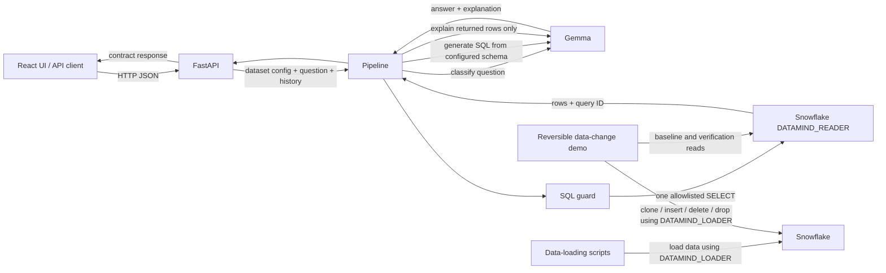

# DataMind backend architecture

The React UI is an API consumer; the API schema and status behavior are defined
by [`api_contract.md`](./api_contract.md). During development, Vite proxies API
requests to FastAPI. In a built deployment, FastAPI serves `frontend/dist`
from `/` while preserving the `/api/*` routes.

## Computation and language-model boundary

Gemma performs language tasks only: it classifies a request, proposes one SQL
query using the selected YAML schema, and explains the rows returned by
Snowflake. It is not the source of computed results. The SQL guard checks
read-only syntax, table scope, and row limits before execution; Snowflake runs
the query and returns the evidence (including its query ID). The answer
explanation is grounded in those returned rows.

Dataset metadata, columns, examples, and join keys live in
`backend/config/*.yaml`.
The API discovers the YAML files when it builds its dataset catalog and caches
pipelines by config path; adding a valid config does not require a dataset
branch in the API.

## Snowflake roles

- `DATAMIND_READER` is the role used by the API, pipeline, live verifier, and
  evaluation reads. Its application privileges are SELECT-only.
- `DATAMIND_LOADER` is used only by `backend/scripts/load_data.py` and
  `backend/scripts/demo_data_change.py`. It performs the data load and the controlled
  writes on the demo clone, never application question queries. It also needs
  source SELECT access to make that clone.
- Reader sessions disable secondary roles, so the loader role granted to the
  same Snowflake user does not become active in application sessions.

## API surface

The frontend-facing endpoints are `GET /api/health`, `GET /api/datasets`, and
`POST /api/ask`. Requests select a dataset by the stable ID derived from its
configured display name. See the complete schemas and status rules in
[`api_contract.md`](./api_contract.md).
